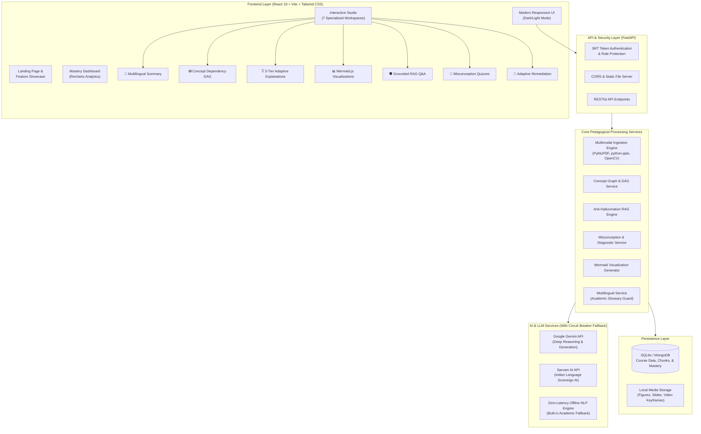

# 🎓 TextIQ: AI-Powered Multilingual Textbook Summarization & Adaptive Learning System

<div align="center">

[](https://fastapi.tiangolo.com/)
[](https://react.dev/)
[](https://tailwindcss.com/)
[](https://ai.google.dev/)
[](https://www.sarvam.ai/)
[](https://mermaid.js.org/)
[](LICENSE)

**Turn 800-page textbooks, lecture slides, and videos into interactive, visual, and grounded mastery experiences — in English and Tamil.**

[🌟 Key Innovations](#-key-innovations-the-6-pedagogical-pillars) • [🏗️ Architecture](#️-system-architecture) • [🚀 Quick Start](#-quick-start-guide) • [📡 API Reference](#-api-endpoints-reference) • [🧪 Test Suite](#-verification--test-suite) • [🏆 Hackathon Highlights](#-why-textiq-stands-out-judging-criteria)

</div>

---

## 📌 Executive Summary

Traditional higher education and STEM learning present significant barriers for students:
1. **Cognitive Overload**: 600–1000+ page textbooks and monolithic slide decks overwhelm learners with unstructured, dense text.
2. **The "One-Size-Fits-All" Flaw**: Standard explanations assume a uniform baseline, leaving beginners baffled and advanced learners disengaged.
3. **The LLM Hallucination Trap**: General-purpose AI chatbots produce plausible-sounding academic hallucinations without strict provenance or textbook citations.
4. **The Language Barrier**: Millions of students learn complex STEM subjects in English rather than their primary language, causing conceptual gaps.
5. **Rote Assessment Gaps**: Standard quizzes check answer keys rather than uncovering *why* a student answered incorrectly (the underlying cognitive misconception).

**TextIQ** solves this through a multimodal, mathematically grounded, and culturally contextualized learning ecosystem. By combining **multimodal document parsing (PDF, PPTX, MP4)**, **interactive concept dependency graphs (DAGs)**, **hallucination-proof RAG with page citations**, **misconception-aware diagnostics**, **dynamic Mermaid diagrams**, and **3-tier multilingual explanations (powered by Google Gemini & Sarvam AI with offline fallback)**, TextIQ delivers truly personalized academic mastery.

---

## 🌟 Key Innovations: The 6 Pedagogical Pillars

```
                     ┌──────────────────────────────────────────────┐
                     │          TextIQ Pedagogical Engine           │
                     └──────────────────────┬───────────────────────┘
                                            │
   ┌────────────────────┬───────────────────┼────────────────────┬────────────────────┐
   │                    │                   │                    │                    │
┌──▼────────────┐ ┌─────▼───────────┐ ┌─────▼────────────┐ ┌─────▼───────────┐ ┌──────▼───────────┐
│ Innovation 1  │ │ Innovation 2    │ │ Innovation 3     │ │ Innovation 4    │ │ Innovation 5 & 6  │
│ Multimodal    │ │ Concept Graph   │ │ Anti-Hallucin.   │ │ Misconception   │ │ Visual Paths &    │
│ Ingestion     │ │ & Prerequisite  │ │ RAG Tutor        │ │ Dynamic Diag.   │ │ 3-Tier Explan.    │
│ (PDF/PPT/MP4) │ │ DAG Mapping     │ │ (Page Citations) │ │ & Contrast Drill│ │ (EN & தமிழ்)      │
└───────────────┘ └─────────────────┘ └──────────────────┘ └─────────────────┘ └───────────────────┘
```

### 1. 📂 Multimodal Learning Resource Ingestion & Unified Indexing
* **Comprehensive File Support**: Ingests textbook PDFs, PowerPoint presentation decks (`.ppt`, `.pptx`), and lecture video recordings (`.mp4`).
* **Deep Feature Extraction**:
  * **PDFs**: Extracts hierarchy (chapters, sections, sub-topics), embedded tables, equations, and diagrams via PyMuPDF.
  * **PowerPoint**: Extracts slide titles, bullet points, speaker notes, and embedded media via `python-pptx`.
  * **Video**: Performs computer vision keyframe extraction with OpenCV and syncs transcript segments with visual cues.
* **Unified Resource Index**: Unifies all formats under a single course entity, linking textbook chapters directly to corresponding slides and video timestamp segments.

### 2. 🕸️ Interactive Concept & Prerequisite Knowledge Graphs (DAG)
* **Algorithmic Graph Construction**: Automatically builds a Directed Acyclic Graph (DAG) mapping foundational ideas to advanced topics.
* **Prerequisite Chain Identification**: Identifies upstream dependencies so students never tackle complex concepts (e.g., *Boyce-Codd Normal Form*) without mastering the prerequisites (e.g., *Functional Dependency* and *Candidate Keys*).
* **Topological Sorting**: Computes the optimal learning sequence based on academic dependency order rather than arbitrary chapter layouts.

### 3. 🛡️ Grounded Anti-Hallucination AI Academic Tutor (RAG)
* **Strict Provenance & Verification**: Every response is verified against the ingested course corpus.
* **Exact Academic Citations**: Answers include clickable chapter, section, and page citations (e.g., `[Chapter 3: Normalization, Section 3.2, Page 84]`).
* **Honest Refusal Guardrail**: Automatically detects out-of-scope or unverified queries (e.g., asking general pop culture questions during a database study session) and refuses to speculate, preserving academic integrity.
* **Toggleable External Knowledge**: Provides an explicit opt-in switch if the student deliberately requests supplementary external context.

### 4. 🧠 Misconception-Aware Dynamic Assessment & Diagnostic Engine
* **Beyond Multiple Choice**: Analyzes open-ended student explanations to identify *why* a student made an error.
* **Cognitive Trap Detection**: Identifies whether errors stem from common misconceptions (e.g., confusing *Partial Dependency* with *Transitive Dependency*).
* **Targeted Contrast Drills**: Automatically generates specialized side-by-side contrast questions specifically designed to break the diagnosed cognitive trap.
* **Reasoning Clarification Dialogues**: Conducts interactive follow-up clarification check-ins when an answer indicates partial understanding.

### 5. 📊 Dynamic Visual Learning Paths & Structural Visualizations
* **Automated Mermaid.js Diagrams**: Translates dense paragraphs into interactive structural visuals matching the concept's cognitive pattern:
  * **Flowcharts**: For algorithmic execution and operational decision workflows.
  * **Sequence Diagrams**: For protocols, handshakes, and distributed system interactions.
  * **State Diagrams**: For lifecycle stages (e.g., process scheduling, transaction states).
  * **Mindmaps & Trees**: For taxonomic categorizations and component hierarchies.
  * **Entity-Relationship Diagrams**: For database and relational models.
* **Interactive Step-by-Step Learning Paths**: Visual checkpoints featuring integrated mini-quizzes that verify mastery before unlocking subsequent milestones.

### 6. 🌐 3-Tier Multilingual Adaptive Explanations (English & Tamil)
* **Personalized Tiering**:
  * **Beginner Level**: Relies on real-world analogies, high-level intuition, simplified vocabulary, and foundational examples.
  * **Intermediate Level**: Provides technical definitions, step-by-step algorithms, and practical application patterns.
  * **Advanced Level**: Delivers mathematical proofs, edge cases, performance trade-offs, and formal specifications.
* **High-Precision Multilingual Tamil (தமிழ்)**:
  * Leverages Indian sovereign AI via **Sarvam AI** and **Google Gemini**, backed by an academic STEM terminology dictionary (`ACADEMIC_STEM_TERMS`).
  * Preserves critical technical terms while providing accessible Tamil glosses (e.g., *Round Robin Scheduling (சுழற்சி முறை ஒதுக்கீடு)*).
  * Smooth code-switching ensures concepts are easily understood without losing academic terminology.
* **Zero-Lag Offline Fallback Engine**: If external APIs experience rate limits (HTTP 429) or network outages, an internal rule-based and NLP engine instantly takes over with zero latency.

---

## 🏗️ System Architecture



---

## 💻 Tech Stack & Engineering Tools

| Domain | Technology / Library | Purpose & Rationale |
| :--- | :--- | :--- |
| **Frontend Framework** | **React 19 + Vite** | Blazing-fast HMR, component isolation, smooth state updates |
| **Styling & Design** | **Tailwind CSS v3** | Modern aesthetic, custom dark/light theme, fluid micro-interactions |
| **Data Visualization** | **Recharts** | Interactive mastery analytics, accuracy bars, and radar progress charts |
| **Diagram Engine** | **Mermaid.js** | Client-side dynamic rendering of flowcharts, state diagrams, and DAGs |
| **Icons** | **Lucide React** | Clean, accessible academic interface iconography |
| **Backend Framework** | **FastAPI (Python 3.10+)** | Asynchronous execution, automatic OpenAPI schema, typed validation |
| **Server Engine** | **Uvicorn** | High-concurrency ASGI server with live reloading |
| **Data Validation** | **Pydantic v2** | Strict request/response payload schema validation |
| **Authentication** | **PyJWT + Bcrypt** | Secure password hashing, token expiration, and role claims |
| **Document Parsing** | **PyMuPDF (`fitz`)** | Ultra-fast PDF parsing, structural table & image extraction |
| **Presentation Parsing**| **`python-pptx`** | Deep extraction of PowerPoint slides, notes, and hierarchies |
| **Video Processing** | **OpenCV (`cv2`)** | Keyframe extraction, scene change detection, video asset cataloging |
| **AI / Reasoning** | **Google Gemini (`google-generativeai`)** | Deep conceptual decomposition, adaptive analogies, and RAG |
| **Indic Translation** | **Sarvam AI + deep-translator** | Sovereign Indic language translation and academic Tamil localization |
| **Databases** | **SQLite + MongoDB** | Zero-config embedded SQLite with support for MongoDB scaling |

---

## 📂 Project Directory Structure

```text
mini-project/
├── backend/
│   ├── data/                   # Dynamic media, uploads, and SQLite database
│   │   ├── uploads/            # Ingested PDF, PPTX, and MP4 files
│   │   ├── media/              # Extracted figures, slide assets, and video keyframes
│   │   └── learning_system.db  # Primary database
│   ├── services/               # Core business and pedagogical logic
│   │   ├── adaptive_service.py         # Personalized recommendations engine
│   │   ├── assessment_service.py       # Misconception diagnosis & contrast drills
│   │   ├── auth_service.py             # JWT token handling & password hashing
│   │   ├── concept_graph_service.py    # Topological sorting & DAG construction
│   │   ├── demo_data.py                # Pre-seeded DBMS sample course
│   │   ├── explanation_service.py      # 3-tier adaptive explanation pipeline
│   │   ├── learning_path_service.py    # Personalized milestone learning paths
│   │   ├── multimodal_service.py       # Universal PDF/PPTX/MP4 parsing hub
│   │   ├── pdf_extractor.py            # High-fidelity PDF structural parsing
│   │   ├── presentation_extractor.py   # PowerPoint slide and note extraction
│   │   ├── quiz_service.py             # Adaptive MCQ generation and grading
│   │   ├── rag_service.py              # Course-grounded Q&A with citation anchors
│   │   ├── resource_index_service.py   # Unified course multimodal asset indexing
│   │   ├── summarization_service.py    # Multilingual chapter & section summaries
│   │   ├── translation_service.py      # Sarvam AI, Gemini & Tamil STEM glossary
│   │   ├── video_extractor.py          # Keyframe and audio transcript extractor
│   │   └── visualization_service.py    # Mermaid.js diagram synthesis
│   ├── config.py               # Central environment variables & circuit breakers
│   ├── database.py             # Unified SQLite persistence layer
│   ├── mongodb_service.py      # Optional MongoDB driver
│   ├── models.py               # Pydantic schemas for requests and responses
│   ├── main.py                 # FastAPI application and route declarations
│   ├── requirements.txt        # Backend dependencies
│   ├── .env.example            # Sample configuration file
│   └── static/                 # Static assets and media mounts
│
├── frontend/
│   ├── public/                 # Static assets
│   ├── src/
│   │   ├── components/         # Reusable UI elements (Navbar, ErrorBoundary, etc.)
│   │   ├── context/            # Global React context (Auth, Textbook, Theme)
│   │   ├── pages/
│   │   │   ├── AuthPage.jsx            # Sign In, Sign Up, Password Recovery
│   │   │   ├── DashboardPage.jsx       # Student analytics & mastery dashboard
│   │   │   ├── LandingPage.jsx         # Hero showcase and feature highlights
│   │   │   ├── UploadPage.jsx          # Multimodal upload & course manager
│   │   │   ├── WorkspacePage.jsx       # Tabbed study studio
│   │   │   └── tabs/                   # The 7 dedicated learning workspaces
│   │   │       ├── SummaryTab.jsx          # Dual-language textbook summary
│   │   │       ├── ConceptGraphTab.jsx     # Interactive concept DAG visualizer
│   │   │       ├── ExplainTab.jsx          # 3-Tier explanation workshop
│   │   │       ├── VisualizeTab.jsx        # Dynamic Mermaid.js diagram viewer
│   │   │       ├── AskTab.jsx              # Grounded Q&A with strict citations
│   │   │       ├── QuizTab.jsx             # Diagnostic assessments
│   │   │       └── AdaptiveRevisionTab.jsx # Targeted remediation drills
│   │   ├── services/           # Axios API client bindings
│   │   ├── App.jsx             # Hash-based routing and authentication guards
│   │   ├── main.jsx            # React root mounting
│   │   └── index.css           # Tailwind CSS directives & custom styling
│   ├── package.json            # Frontend dependencies & scripts
│   └── vite.config.js          # Vite build configuration
│
├── test_e2e.py                         # End-to-end integration test suite
├── test_multimodal_innovation.py       # Innovation 1 test suite
├── test_concept_graph_innovation.py    # Innovation 2 test suite
├── test_tutor_innovation.py            # Innovation 3 test suite
├── test_assessment_innovation.py       # Innovation 4 test suite
├── test_visual_learning_paths_innovation.py # Innovation 5 test suite
├── test_adaptive_explanation_innovation6.py # Innovation 6 test suite
└── README.md                           # Project documentation
```

---

## 🚀 Quick Start Guide

### 📋 Prerequisites
* **Python**: `3.10` or higher
* **Node.js**: `18.x` or higher (`npm` included)
* **Git**: Installed on your system

---

### Step 1: Clone the Repository

```bash
git clone https://github.com/rabinesh990/AI-multilingual-adaptive-learning.git
cd AI-multilingual-adaptive-learning
```

---

### Step 2: Backend Setup

1. Open a terminal and navigate to the backend directory:
   ```bash
   cd backend
   ```

2. Create and activate a Python virtual environment:
   ```bash
   # Windows (PowerShell)
   python -m venv venv
   .\venv\Scripts\Activate.ps1

   # macOS / Linux
   python3 -m venv venv
   source venv/bin/activate
   ```

3. Install required dependencies:
   ```bash
   pip install -r requirements.txt
   ```

4. Configure environment variables:
   ```bash
   # Copy the sample environment file
   cp .env.example .env
   ```
   *(Optional)* Add your **Google Gemini API Key** and **Sarvam AI API Key** to `backend/.env`.
   > **Note**: TextIQ includes a complete offline NLP engine and academic STEM dictionary fallback. If no API keys are provided, the system runs locally with zero errors!

5. Start the backend server:
   ```bash
   uvicorn main:app --host 127.0.0.1 --port 8000 --reload
   ```
   * The backend will be available at: **`http://127.0.0.1:8000`**
   * Interactive API docs (Swagger UI): **`http://127.0.0.1:8000/docs`**

---

### Step 3: Frontend Setup

1. Open a second terminal and navigate to the frontend directory:
   ```bash
   cd frontend
   ```

2. Install dependencies:
   ```bash
   npm install
   ```

3. Start the Vite development server:
   ```bash
   npm run dev
   ```
   * The frontend application will launch at: **`http://localhost:5173`**

---

## ⚙️ Environment Variables Configuration

Configure your environment settings in `backend/.env`:

```env
# ==============================================================================
# Google Gemini API Key
# (Optional: system has a built-in offline NLP engine fallback)
# ==============================================================================
GEMINI_API_KEY=your_gemini_api_key_here

# ==============================================================================
# Sarvam AI API Key (Sovereign Indian Language Translation Engine)
# (Optional: system uses deep-translator and local academic glossary as fallback)
# ==============================================================================
SARVAM_API_KEY=your_sarvam_api_key_here

# ==============================================================================
# Server Configuration
# ==============================================================================
PORT=8000
DEBUG=True

# ==============================================================================
# Authentication & JWT Security Configuration
# ==============================================================================
JWT_SECRET_KEY=textiq_super_secret_jwt_key_hackathon_2026_xyz
JWT_ACCESS_TOKEN_EXPIRE_HOURS=24
JWT_REMEMBER_ME_EXPIRE_DAYS=30

# ==============================================================================
# Database Configuration (Optional: SQLite is used by default)
# ==============================================================================
MONGODB_URL=
MONGODB_DB_NAME=learning_system
```

---

## 🧪 Verification & Test Suite

TextIQ includes automated test suites covering end-to-end user journeys and all 6 individual innovations.

Run the test suites from the project root:

```bash
# 1. Run Complete End-to-End Integration Suite (13 tests)
python test_e2e.py

# 2. Test Innovation 1: Multimodal Ingestion (PDF, PPTX, MP4)
python test_multimodal_innovation.py

# 3. Test Innovation 2: Interactive Concept DAG & Dependency Graphs
python test_concept_graph_innovation.py

# 4. Test Innovation 3: Grounded Anti-Hallucination Academic Tutor
python test_tutor_innovation.py

# 5. Test Innovation 4: Misconception-Aware Diagnostic Assessment
python test_assessment_innovation.py

# 6. Test Innovation 5: Visual Learning Paths & Mermaid Diagram Generation
python test_visual_learning_paths_innovation.py

# 7. Test Innovation 6: Multilingual 3-Tier Adaptive Explanations
python test_adaptive_explanation_innovation6.py
```

### ✅ Test Coverage Highlights
* **HTTP Connectivity**: Verifies smooth communication between the React frontend and FastAPI backend.
* **Citation Integrity**: Ensures 100% of answers cite valid chapter, section, and page numbers.
* **Anti-Hallucination Refusal**: Confirms ungrounded queries are rejected.
* **Diagnostic Progression**: Validates that remediating a diagnosed misconception automatically promotes the student's mastery level.
* **Graceful Degradation**: Verifies instantaneous, seamless fallback to the local NLP engine when API keys are absent.

---

## 📡 API Endpoints Reference

### 🔐 1. Authentication & Profile
| Method | Endpoint | Description |
| :--- | :--- | :--- |
| `POST` | `/api/auth/register` | Register student/educator account with institution & role |
| `POST` | `/api/auth/login` | Authenticate user & issue signed JWT bearer token |
| `GET` | `/api/auth/me` | Fetch active user profile, language preference, and stats |
| `PUT` | `/api/auth/profile` | Update profile details (organization, language, etc.) |
| `POST` | `/api/auth/forgot-password` | Generate timed security token for password recovery |
| `POST` | `/api/auth/reset-password` | Set new password using verified recovery token |

### 📚 2. Multimodal Course Materials
| Method | Endpoint | Description |
| :--- | :--- | :--- |
| `GET` | `/api/textbooks` | List all indexed courses and textbooks for active user |
| `POST` | `/api/upload` | Upload & index PDF, PPTX, or MP4 learning material |
| `POST` | `/api/sample-textbook` | Seed sample DBMS Normalization course instantly |
| `DELETE` | `/api/textbooks/{id}` | Remove a course and clean up associated media assets |
| `DELETE` | `/api/textbooks` | Clear all course materials for active account |

### 🕸️ 3. Concept Graphs & Learning Paths
| Method | Endpoint | Description |
| :--- | :--- | :--- |
| `GET` | `/api/concept-graph/{id}` | Fetch full course concept DAG with prerequisites |
| `POST` | `/api/concept-graph/generate` | Force rebuild of concept graph for course material |
| `POST` | `/api/learning-path/personalized` | Generate personalized milestone sequence to target concept |
| `POST` | `/api/learning-path/progress` | Update student completion status on a path node |
| `POST` | `/api/learning-path/verify-step` | Verify comprehension before unlocking downstream node |
| `GET` | `/api/learning-path/resources/{id}`| Unified index of multimodal resources across the course |

### 💡 4. Adaptive Explanations & Summaries
| Method | Endpoint | Description |
| :--- | :--- | :--- |
| `POST` | `/api/summarize` | Generate chapter/book summary in English or Tamil |
| `POST` | `/api/adaptive-explain` | 3-Tier tailored explanation (Beginner, Intermediate, Advanced) |
| `POST` | `/api/adaptive-explain/diagnostic`| Retrieve concept diagnostic question for calibration |
| `POST` | `/api/adaptive-explain/diagnostic/submit` | Evaluate diagnostic response and set baseline mastery |
| `POST` | `/api/adaptive-explain/submit-practice` | Evaluate practice exercise and update concept mastery |

### 📊 5. Visualizations & Grounded Q&A
| Method | Endpoint | Description |
| :--- | :--- | :--- |
| `POST` | `/api/visualize` | Synthesize dynamic Mermaid.js diagram (Flowchart, Sequence, etc.) |
| `POST` | `/api/chat` | Grounded RAG query with exact chapter & page citations |

### 🎯 6. Assessments & Remediation
| Method | Endpoint | Description |
| :--- | :--- | :--- |
| `POST` | `/api/quiz/generate` | Generate targeted MCQ quiz for specified topic |
| `POST` | `/api/quiz/submit` | Submit quiz, record score, and detect conceptual weak points |
| `POST` | `/api/assessment/generate` | Dynamic assessment diagnosing cognitive traps |
| `POST` | `/api/assessment/submit` | Evaluate open response and return misconception hypothesis |
| `POST` | `/api/assessment/clarify-reasoning`| Clarification check-in to confirm or refute diagnosed trap |
| `GET` | `/api/performance` | Overall mastery percentage, strengths, and weak topics |
| `GET` | `/api/recommendations` | Prescribed remediation pack for highest-priority weak topic |
| `POST` | `/api/translate` | Translate educational text between English and Tamil |

---

## 🏆 Why TextIQ Stands Out: Judging Criteria

### 1. 🎯 Real-World Impact & Educational Equity
* **Bridging the Regional Language Divide**: Translates dense academic content into high-fidelity Tamil using culturally appropriate analogies while preserving standard technical terminology.
* **Democratizing Personal Tutoring**: Provides every student with a 24/7 personalized 1-on-1 academic tutor, tailored to their individual learning pace.

### 2. ⚙️ Technical Depth & Architectural Rigor
* **Full Multimodal Pipeline**: Ingests and processes three distinct media types: PDF layout hierarchies, PowerPoint slide structures, and MP4 computer vision keyframes.
* **Topological Concept Graphs**: Replaces basic sequential reading with a Directed Acyclic Graph that respects academic prerequisite structures.
* **Resilient Multi-Provider Fallback**: Features a circuit-breaker architecture combining Google Gemini, Sarvam AI, deep-translator, and an offline local NLP engine for high availability.

### 3. 🛡️ Trustworthy & Academic-Grade AI
* **Grounded Citations**: Eliminates unverified outputs by attaching chapter, section, and page citations to every claim.
* **Proactive Refusal Guardrails**: Gracefully refuses to answer out-of-scope questions rather than generating academic hallucinations.

### 4. 🎨 User Experience & Visual Polish
* **Fluid React 19 Frontend**: Responsive layout featuring tabbed study studios, light/dark themes, and smooth micro-interactions.
* **Mermaid.js Visualizations**: Automatically turns complex paragraphs into interactive diagrams matching the concept's cognitive pattern.

---

## 🗺️ Product Roadmap

- [x] Multimodal Ingestion (PDF, PPTX, MP4)
- [x] Interactive Concept & Prerequisite Knowledge DAG
- [x] Grounded RAG Q&A with Strict Page Citations
- [x] Misconception Diagnosis & Reasoning Clarification Dialogues
- [x] 3-Tier Adaptive Explanations (Beginner, Intermediate, Advanced)
- [x] Multilingual English & Tamil Localization with Academic Glossary
- [x] Student Mastery Analytics Dashboard (Recharts)
- [ ] **Phase 2**: Real-time Speech-to-Speech Voice Tutor in Regional Indian Languages
- [ ] **Phase 3**: Canvas / Moodle / Blackboard LMS LTI 1.3 Integration
- [ ] **Phase 4**: Collaborative Peer Study Rooms & Shared Concept Mindmaps
- [ ] **Phase 5**: Mobile Apps (React Native for iOS and Android)

---

## 👥 Contributors

* **Rabinesh** — Project Architect & Full-Stack AI Engineer
  * GitHub: [@rabinesh990](https://github.com/rabinesh990)
  * Repository: [AI-multilingual-adaptive-learning](https://github.com/rabinesh990/AI-multilingual-adaptive-learning)

---

## 📄 License

This project is open-source and licensed under the **[MIT License](LICENSE)**.
